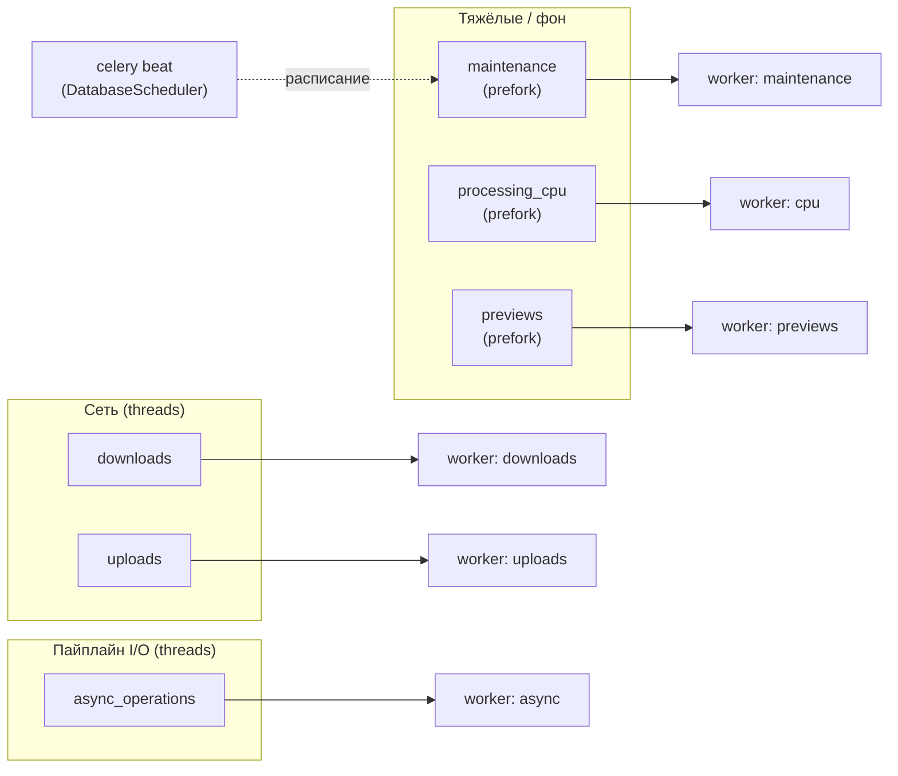

# Celery Workers: Operations Guide

> **Быстрый старт (все воркеры в фоне):** `make celery-start` (поднимает Redis через Homebrew, затем 6 worker-процессов + beat)
> **Техника asyncio + threads:** [CELERY_ASYNCIO_TECHNICAL.md](CELERY_ASYNCIO_TECHNICAL.md)
> **Маршрутизация в коде:** `api/celery_app.py` → `task_routes`

## Overview

Очереди разделены по типу нагрузки: сеть (скачивание / загрузка), быстрый I/O пайплайна (транскрипция, оркестрация), CPU (FFmpeg), обслуживание. Источник правды по именам очередей и задач — `api/celery_app.py`.



---

## Очереди и команды Makefile

| Очередь | Pool | Concurrency (Makefile) | Команда |
|---------|------|--------------------------|---------|
| `downloads` | threads | 20 | `make celery-downloads` |
| `uploads` | threads | 20 | `make celery-uploads` |
| `async_operations` | threads | 28 | `make celery-async` |
| `processing_cpu` | prefork | 6 (`--max-tasks-per-child=20`) | `make celery-cpu` |
| `previews` | prefork | 1 | `make celery-previews` |
| `maintenance` | prefork | 1 | `make celery-maintenance` |

Планировщик: `make celery-beat` — `--scheduler celery_sqlalchemy_scheduler.schedulers:DatabaseScheduler` (периодика автоматизаций в БД **и** статическое расписание из `beat_schedule` в `api/celery_app.py`).

---

## Маршрутизация задач (по факту `task_routes`)

| Очередь | Задачи (имена Celery) |
|---------|------------------------|
| `processing_cpu` | `api.tasks.processing.trim_video` |
| `previews` | `api.tasks.processing.generate_video_previews`, `generate_poster` |
| `downloads` | `api.tasks.processing.download_recording` |
| `uploads` | `api.tasks.upload.*` (`upload_recording_to_platform`, `batch_upload_recordings`) |
| `async_operations` | `api.tasks.processing.enqueue_video_previews`, `transcribe_recording`, `extract_topics`, `generate_subtitles`, `batch_transcribe_recording`, `run_recording`, `launch_uploads`, `finalize_pipeline`; `api.tasks.template.*`; `api.tasks.sync.*`; `api.tasks.share_events.persist_batch`; `api.tasks.product_updates.send_batch`; `automation.*` (`automation.run_job`, `automation.dry_run`) |
| `maintenance` | `maintenance.*` — включая `reset_stale_active_recordings` (каждые 30 минут), `requeue_stale_video_previews` (каждые 15 минут), `reconcile_upload_dispatches` (каждые 5 минут), `reconcile_transcription_ledger` и `snapshot_storage_usage` (ежечасно); `celery.backend_cleanup` |

**Зачем отдельные `downloads` и `uploads`:** изоляция сетевой полосы и долгих передач от остального I/O пайплайна (см. комментарии в `api/celery_app.py`).

**Почему threads для сети и пайплайна:** совместимость с asyncio/asyncpg в воркере; gevent здесь не используется — см. [CELERY_ASYNCIO_TECHNICAL.md](CELERY_ASYNCIO_TECHNICAL.md).

**Почему prefork для CPU:** отдельные процессы ограничивают влияние обработки и библиотек друг на друга. Сам FFmpeg запускается отдельным подпроцессом и потребляет CPU сверх Celery-процесса.

**Почему один процесс maintenance:** последовательное выполнение фоновых чисток снижает гонки; периодика задаётся в `beat_schedule` (UTC). В Compose для них выделен отдельный worker.

---

## Запуск

### Все воркеры + beat (фон)

```bash
make celery-start   # Redis (brew) + 6 workers + beat, логи в logs/
make celery-stop
make celery-status
make celery-purge    # очистить очереди (осторожно)
```

### Ручной запуск по терминалам (разработка)

```bash
make celery-downloads
make celery-uploads
make celery-async
make celery-cpu
make celery-previews
make celery-maintenance
make celery-beat
```

### Один процесс на все очереди (только локально)

`make celery-dev` — один worker, очереди `processing_cpu,async_operations,downloads,uploads,maintenance,previews`, **prefork**, concurrency 4. Удобно для отладки, не отражает прод-разбиение по процессам.

### Мониторинг

```bash
make flower   # http://localhost:5555
```

---

## Масштабирование

- **Вертикально:** у локальных выделенных workers можно менять concurrency конкретной очереди. В Compose `CELERY_WORKER_CONCURRENCY` увеличивает число процессов общего worker сразу для всех его очередей.
- **Горизонтально:** несколько машин с теми же именами очередей; Redis как общий broker.
- **CPU pool:** учитывайте процессы trim и previews, а также отдельные процессы FFmpeg. На одной машине задавайте параллельность по измеренным CPU, памяти и временно занятому диску. `max-tasks-per-child` задан для prefork CPU-воркера в Makefile.

Табличные «размеры под N пользователей» зависят от профиля нагрузки; ориентируйтесь на длину очередей (Flower / `inspect active`) и latency задач.

---

## Отличия Docker Compose

В `docker-compose.yml` `celery_worker` слушает `downloads,uploads,async_operations` и временно legacy-очередь `celery` (6 prefork процессов, лимит 2 CPU / 3G). `celery_cpu_worker` слушает только `processing_cpu` (1 процесс, 1.5 CPU / 2G), `celery_preview_worker` — только `previews` (1 процесс, 1 CPU / 2G), `celery_maintenance_worker` — только `maintenance` (1 процесс, 0.5 CPU / 512M). `CELERY_WORKER_CONCURRENCY`, `CELERY_CPU_CONCURRENCY` и `PREVIEW_WORKER_CONCURRENCY` можно менять после измерения потребления ресурсов. Beat запускается отдельно. Legacy-подписка нужна для сообщений со старой маршрутизацией. Локальные 76 слотов Makefile не являются рекомендуемой нагрузкой для production VM.

Проверка здоровья контейнера подтверждает наличие процесса и доступность Redis/PostgreSQL; она не выполняет тестовую Celery-задачу. Зависшие очереди проверяйте по глубине и возрасту задач. `restart: unless-stopped` перезапускает завершившийся процесс, но не контейнер только со статусом `unhealthy`. Деплой ждёт все четыре worker и Beat перед переключением API.

После `TRIM` отдельная задача ставит `PREVIEW_MAKER` в очередь `previews`, а основная цепочка продолжает транскрипцию. Успех основной цепочки не означает успех превью. Beat через 5 минут повторяет `FAILED`, если попыток меньше трёх; восстанавливает `IN_PROGRESS` старше 70 минут и `PENDING` старше 70 минут при пустой очереди брокера (до 25 за проход). При трёх неудачах автоматическая генерация останавливается; новая ревизия видео снова получает три попытки. Повторная доставка Celery может дать повторное сообщение, поэтому задачи проверяют токен запуска.

### Границы повторов и восстановления

| Участок | Поведение при ошибке |
|---------|----------------------|
| Download / trim / transcription / topics / subtitles | Задачи вызывают `self.retry`; по умолчанию 3 повтора download и 2 повтора этапов обработки. После исчерпания обычная цепочка останавливается, а обработчик ошибки снимает `on_air`. |
| `run_recording` / `finalize_pipeline` | Оркестратор повторяет сбои до резервирования ID цепочки; повторная доставка видит сохранённый ID и не публикует вторую цепочку. После резервирования результат публикации может быть неизвестен: проверяйте зависший `on_air` и очередь. Финализатор повторяется и пропускает уже финализированную запись. |
| `launch_uploads` / `batch_upload_recordings` | Намерение выгрузки и ID задачи сохраняются до отправки в брокер. При частичном сбое launcher становится красным и повторяется; Beat восстанавливает неотправленные сообщения с тем же ID. Начавшуюся внешнюю выгрузку нельзя автоматически повторять при неизвестном результате: цель помечается `FAILED`, общий статус записи пересчитывается, а платформу проверяют перед ручным retry. |
| Preview / poster | `PREVIEW_MAKER` повторяется планировщиком до трёх попыток с проверкой токена и источника. Старый `generate_poster` остаётся отдельным путём с собственным поведением. |
| Maintenance | Восстановление старого `on_air` и осиротевшего `PREVIEW_MAKER` вызывает `self.retry` при ошибке БД/Redis. `on_air` не сбрасывается, пока есть backlog в очередях пайплайна; без недавней активности и backlog статус откатывается, а новый запуск приходит от пользователя или автоматизации. Прочие задачи обслуживания местами возвращают `{status: error}` и потому не используют объявленный `max_retries`. |

Redis transport имеет visibility timeout 3600 секунд по умолчанию, как и общий hard limit задачи. Для долгой работы около часа и при перезапуске контейнера возможна повторная доставка. `task_acks_late` и `task_reject_on_worker_lost` помогают не потерять сообщение при гибели процесса, но не дают exactly once. Следите за временем старейшего сообщения и состоянием `output_targets`. Внешний API и PostgreSQL не участвуют в одной транзакции; при неоднозначном исходе выгрузки нужен ручной разбор.

Публичные beacons публикуют `api.tasks.share_events.persist_batch`. Автоматическая выкладка ждёт успешного CI для того же SHA, затем поднимает worker и ждёт его healthcheck до обновления API: старый worker не знает имя новой задачи и не сохранит принятые события. При ошибке публикации API без повторов Celery переходит к синхронной записи события. Задача не хранит Celery result, повторные доставки безопасны по ID события. При росте трафика наблюдайте lag и глубину `async_operations`: она общая с обработкой видео, поэтому устойчивый backlog замедляет статистику и другие I/O задачи.

---

## Настройки из окружения

Префикс `CELERY_` в `config/settings.py` (`CelerySettings`): broker/backend, лимиты времени, prefetch, retries по типам задач. Broker по умолчанию синхронизируется с Redis из общих настроек (`sync_redis_to_celery`).

---

## Troubleshooting

| Симптом | Куда смотреть |
|---------|----------------|
| Задачи не берутся | `make celery-status`, логи `logs/celery-*.log`, что воркер подписан на нужную очередь (`-Q`) |
| Задача в «не той» очереди | Имя задачи и `task_routes` в `api/celery_app.py` |
| InterfaceError / asyncio | [CELERY_ASYNCIO_TECHNICAL.md](CELERY_ASYNCIO_TECHNICAL.md) |
| Beat не отрабатывает | Процесс beat запущен; для DB-расписания — миграции и `beat_dburi`; статика — `beat_schedule` |

---

## Сводка

| Процессов worker (Makefile) | 6 + отдельный beat |
|----------------------------|---------------------|
| Пример суммарной параллельности | 20 + 20 + 28 + 6 + 1 + 1 = **76** слотов (7 — дочерние процессы prefork CPU и previews) |

---

## Связанные документы

- [CELERY_ASYNCIO_TECHNICAL.md](CELERY_ASYNCIO_TECHNICAL.md) — asyncio, NullPool, threads
- [TECHNICAL.md](../TECHNICAL.md) — API
- [DEPLOYMENT.md](DEPLOYMENT.md) — выкладка

**Последнее обновление:** 2026-10-15
